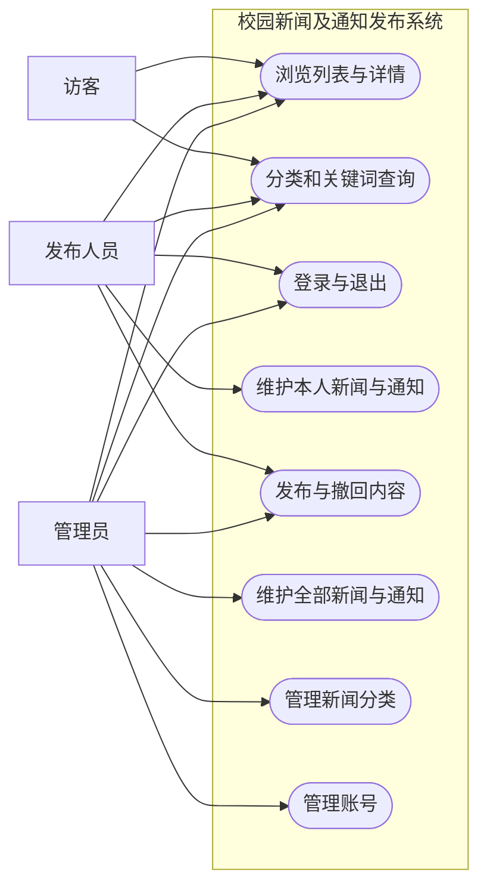

> 第一周需求基线，保留当时设计记录。第二周实际实现请看 [系统设计](05-第二周系统设计.md) 和 [修改与验收指南](06-第二周修改与验收指南.md)。

# 校园新闻及通知发布系统需求分析

课题：校园新闻及通知发布系统设计及实现。学生：韩文涛，学号1023004497，计算机2303班。指导教师：刘传文。

本系统拟统一校园新闻和通知的发布、维护与查询入口。第一周交付需求分析、用例、数据清单及可启动的开发骨架；本文的业务需求均是后续实现与验收的依据，不表示已完成业务代码。

## 1 功能范围

访客不登录即可浏览已发布新闻及通知，按新闻分类和标题关键词查询，分页查看列表并打开详情。发布人员经登录后新增、修改、删除本人内容，并执行发布和撤回；管理员管理全部内容、新闻分类及账号。首版不包含评论、点赞、文件上传、定时发布或复杂审核流程。

新闻保存分类、标题、摘要、正文、作者、创建者和发布时间。通知保存标题、正文、发布单位、创建者和发布时间，不强制关联新闻分类。第一版正文按纯文本处理，以避免直接渲染不可信HTML。

## 2 角色与权限矩阵

| 操作 | 访客 | 发布人员 | 管理员 |
| --- | --- | --- | --- |
| 浏览已发布新闻及通知 | 允许 | 允许 | 允许 |
| 分类、关键词查询与分页 | 允许 | 允许 | 允许 |
| 浏览草稿和撤回内容 | 禁止 | 仅本人 | 全部 |
| 新增内容 | 禁止 | 本人创建 | 允许 |
| 编辑、删除、发布、撤回 | 禁止 | 仅本人内容 | 全部内容 |
| 新闻分类管理 | 禁止 | 禁止 | 允许 |
| 账号管理 | 禁止 | 禁止 | 允许 |

“访客”是未登录状态，不是数据库账号角色。权限须由后端检查登录状态、角色和creator_id，不得只依赖前端隐藏按钮。公开详情也必须检查状态，不能只在列表过滤。

## 3 用例图

以下为Mermaid用例关系图，可在支持Mermaid的Markdown预览中查看。矩形表示系统用例，角色位于系统边界之外。

## 4 核心用例说明

### UC01 浏览及查询新闻

参与者：访客及所有登录用户。前置条件：公开页面可访问。触发条件：用户进入新闻列表或提交查询条件。

主流程：服务端校验页码和每页条数；按已发布状态过滤；可选追加分类及标题关键词条件；按发布时间降序、ID降序返回分页数据；用户点击记录后查看详情。结果：只显示符合条件的已发布内容。

异常分支：无匹配记录显示空状态；页码非法返回参数错误；不存在、草稿或已撤回的公开详情均返回404，避免泄露内容是否存在。通知使用相同的状态与分页规则，查询不含新闻分类条件。

### UC02 登录与退出

参与者：发布人员、管理员。前置条件：账号存在且启用。主流程：用户提交账号和密码；后端验证密码哈希及账号状态；创建服务端会话；返回角色和显示名称；退出时使会话失效。密码不以明文保存，Cookie会话写接口需有CSRF保护。

异常分支：账号不存在、密码错误、账号被禁用均返回统一的认证失败提示；登录失败不创建会话。未登录访问后台接口返回401，权限不足返回403。会话认证、密码哈希及CSRF均为后续实现项。

### UC03 创建及修改内容

参与者：发布人员、管理员。前置条件：已登录且有操作权限。主流程：填写标题、正文，新闻选择有效分类，通知填写发布单位；后端校验数据；从登录态取创建者，不能接受客户端伪造creator_id；新内容以DRAFT保存；返回保存结果。

异常分支：必填为空、标题过长、无效分类返回400；发布人员修改他人内容返回403。已发布内容修改时自动转为DRAFT，从前台下架，确认后重新发布。删除仅允许草稿或撤回内容，已发布内容须先撤回。

### UC04 发布及撤回内容

参与者：内容创建者或管理员。前置条件：已登录、目标内容存在且有操作权限。主流程：检查必填信息与当前状态；从DRAFT或WITHDRAWN发布时改为PUBLISHED，写入本次published_at；撤回时从PUBLISHED改为WITHDRAWN并保留上次发布时间用于追溯。

异常分支：跨账号越权返回403；不存在返回404；重复发布、重复撤回等不合法状态转换返回409。状态变更须在业务事务内完成。撤回后公开列表与详情均不可访问。

### UC05 管理分类和账号

参与者：管理员。分类名称不能重复；已有新闻引用的分类禁止物理删除，可停用，停用分类不再供新内容选择；已发布的历史新闻仍可展示分类名。账号名称唯一；管理员可以禁用发布账号；被内容引用的账号禁止物理删除。后续实现需防止禁用最后一个可用管理员。

## 5 验收规则草案

| 编号 | 场景 | 预期 |
| --- | --- | --- |
| AC01 | 未配置数据库启动后端 | /api/health返回UP，数据库返回NOT_CONFIGURED |
| AC02 | Vue调用后端 | 页面显示服务状态及角色需求 |
| AC03 | 手动配置正确MySQL信息 | 数据库检查返回UP |
| AC04 | 密码错误或服务不可用 | 数据库检查返回503、DOWN，不泄露凭据 |
| AC05 | 访客请求草稿或撤回详情 | 后续实现应返回404 |
| AC06 | 发布人员修改他人内容 | 后续实现应拒绝，返回403 |
| AC07 | 标题为空、分类无效 | 后续实现应拒绝，返回400 |
| AC08 | 发布后查询、撤回后查询 | 后续实现应分别可见、不可见 |

AC01—AC04是本周环境验收范围；AC05—AC08是业务实现后的验收目标。

## 6 下一周安排

完成分层架构设计、主要类图、登录与发布流程图、接口合同和页面原型；复核数据库草案；确定登录、新闻列表、新闻详情和后台编辑页面的交互规则，再分模块开发。

