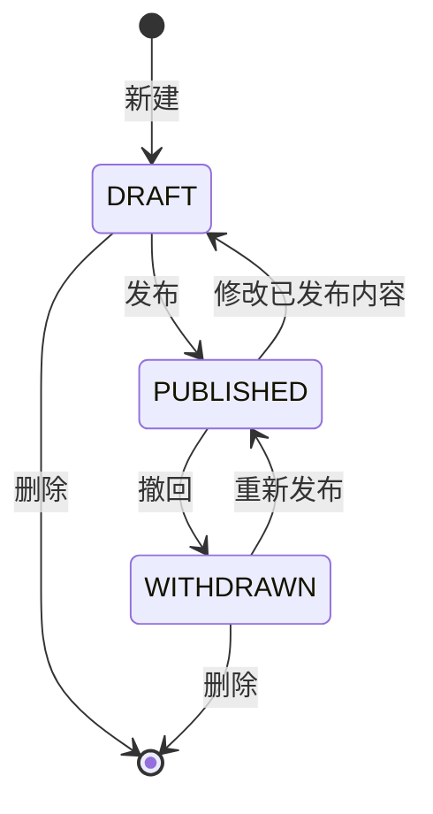
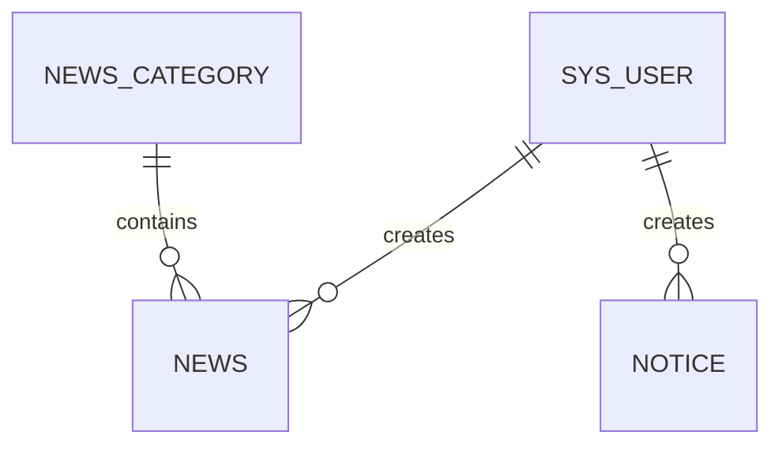

> 第一周需求基线，保留当时设计记录。第二周实际实现请看 [系统设计](05-第二周系统设计.md) 和 [修改与验收指南](06-第二周修改与验收指南.md)。

# 数据清单与状态规则

本清单对应database/schema.sql中的第一周表结构草案。Java枚举仅表达需求中的状态与角色；尚未接入持久化、登录和业务接口。数据库时间统一按北京时间解释，后续接口使用ISO 8601格式。

## 1 用户表 sys_user

| 字段 | 类型 | 规则 |
| --- | --- | --- |
| id | BIGINT UNSIGNED | 主键，自增 |
| username | VARCHAR(50) | 唯一、必填 |
| password_hash | VARCHAR(255) | 必填，后续使用BCrypt等密码哈希，不存明文 |
| display_name | VARCHAR(50) | 必填，页面显示名称 |
| role | VARCHAR(20) | PUBLISHER或ADMIN |
| enabled | BOOLEAN | 是否允许登录 |
| created_at / updated_at | DATETIME | 创建时间与更新时间 |

## 2 新闻分类表 news_category

| 字段 | 类型 | 规则 |
| --- | --- | --- |
| id | BIGINT UNSIGNED | 主键，自增 |
| name | VARCHAR(50) | 唯一、必填 |
| sort_order | INT | 分类排序，默认0 |
| enabled | BOOLEAN | 停用后不供新内容选择 |
| created_at | DATETIME | 创建时间 |

## 3 新闻表 news

| 字段 | 类型 | 规则 |
| --- | --- | --- |
| id | BIGINT UNSIGNED | 主键，自增 |
| category_id | BIGINT UNSIGNED | 外键，关联新闻分类 |
| title | VARCHAR(200) | 去除首尾空白后不能为空 |
| summary | VARCHAR(500) | 可选摘要，默认空字符串 |
| body | MEDIUMTEXT | 非空纯文本正文 |
| author_name | VARCHAR(50) | 作者显示名称，与登录创建者区分 |
| creator_id | BIGINT UNSIGNED | 外键，从登录态确定，不接受客户端指定 |
| status | VARCHAR(20) | DRAFT、PUBLISHED或WITHDRAWN |
| published_at | DATETIME，可空 | 已发布时不可空，再发布更新 |
| created_at / updated_at | DATETIME | 创建时间与更新时间 |

## 4 通知表 notice

| 字段 | 类型 | 规则 |
| --- | --- | --- |
| id | BIGINT UNSIGNED | 主键，自增 |
| title | VARCHAR(200) | 去除首尾空白后不能为空 |
| body | MEDIUMTEXT | 非空纯文本正文 |
| publisher_unit | VARCHAR(100) | 发布单位，必填 |
| creator_id | BIGINT UNSIGNED | 外键，关联用户 |
| status | VARCHAR(20) | 与新闻相同 |
| published_at | DATETIME，可空 | 与新闻相同 |
| created_at / updated_at | DATETIME | 创建时间与更新时间 |

## 5 状态与公开范围

公开列表和详情均须包含status = 'PUBLISHED'条件。正文渲染先按纯文本处理。关键字仅搜索标题，使用参数绑定；页码从1开始，每页默认10条、最多50条。按published_at DESC、id DESC稳定排序。

数据库CHECK约束只校验状态值及部分字段，不能替代权限检查、状态转换、密码哈希和业务层校验。

## 6 表关系

schema.sql不插入账号或样例新闻；samples.json是需求讨论数据，展示已发布、草稿、撤回三种情况。后续实现密码初始化流程后，再用真实创建者和分类ID建立可运行的业务种子数据。

