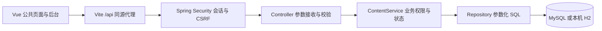
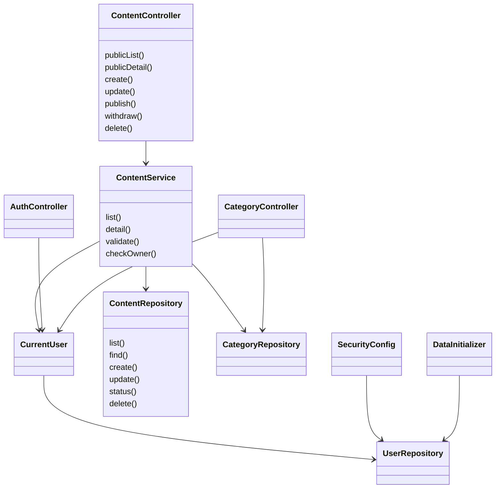
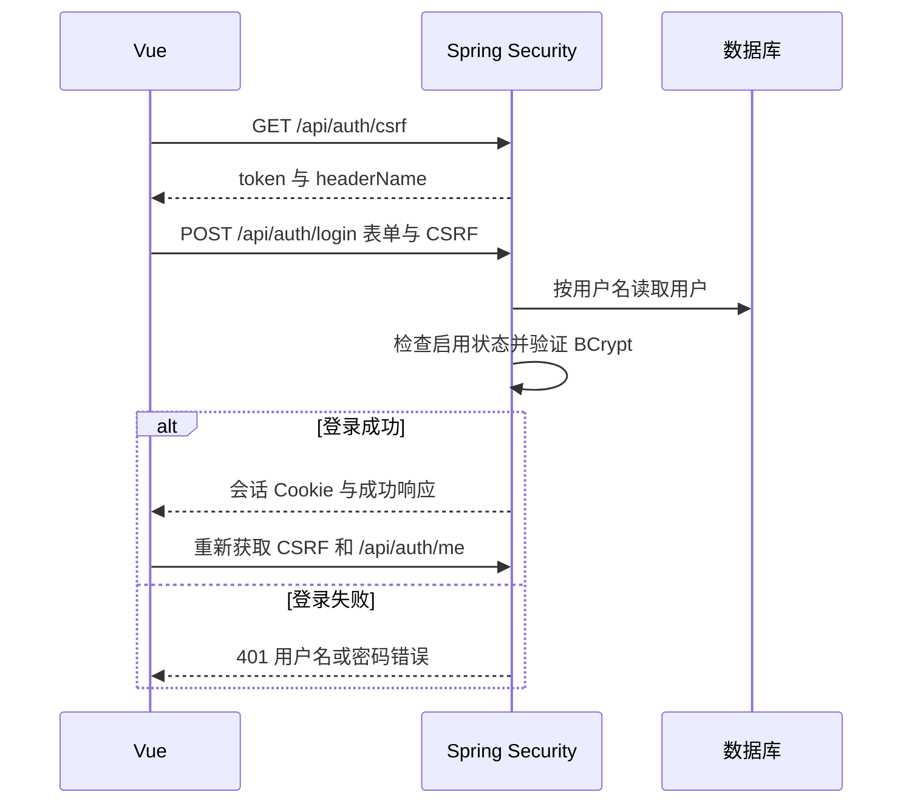
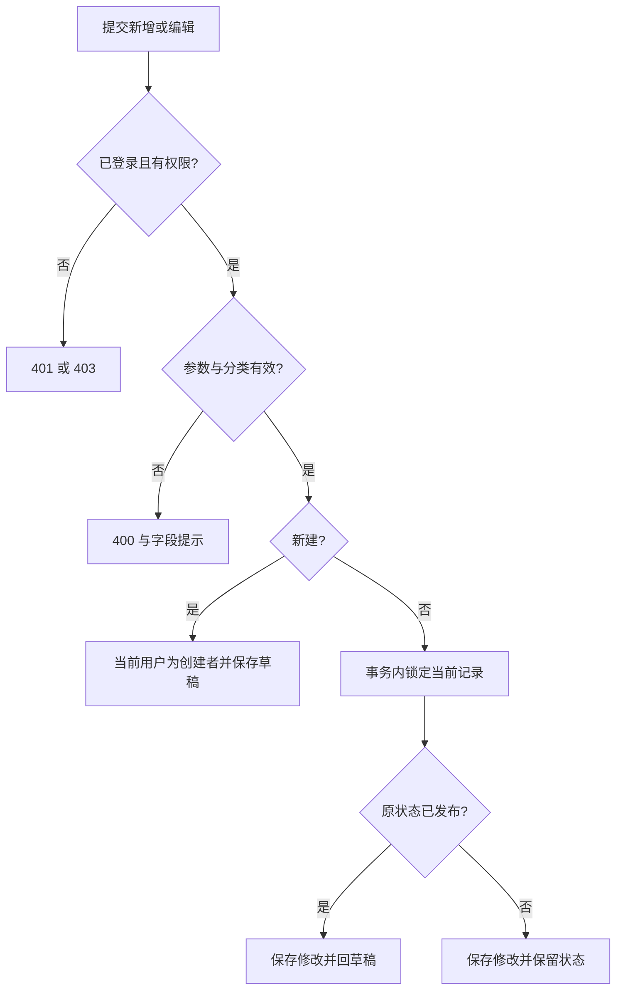
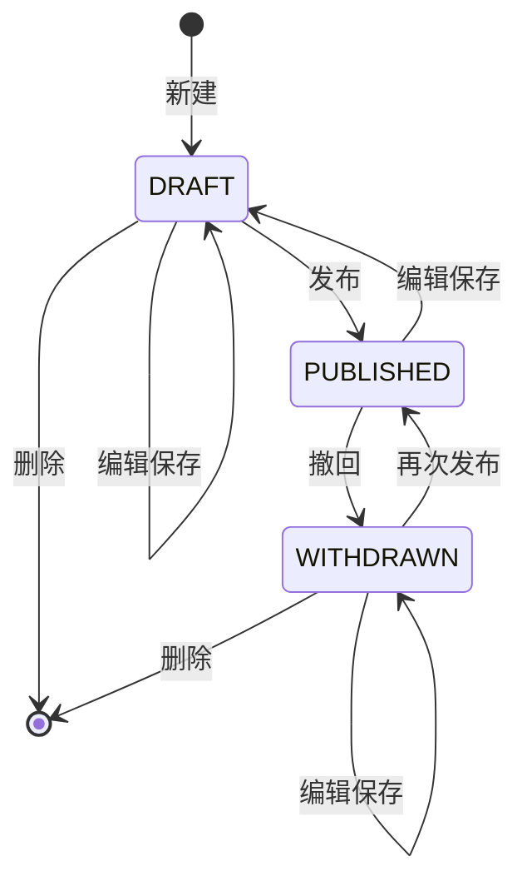

# 第二周系统设计

本文件将第二周周记中的分层、数据结构、页面、接口与流程设计落到可运行代码。第一周文档保留为需求基线；本文件描述第二周实际实现。

## 1 分层结构与主要类





`Models` 集中定义请求与响应 DTO。`UserAccount` 含内部密码哈希，转换为 `UserView` 后才响应。业务异常由 `ApiExceptionHandler` 转换为统一 JSON。分类目前是简单 CRUD，因此分类控制器直接调用 Repository，复杂新闻/通知规则由 Service 负责。

## 2 数据结构与关系

MySQL 沿用第一周的四表，无需新增列。`schema.sql` 中 `IF NOT EXISTS` 只负责初建，不会迁移不匹配的历史表。

| 表 | 主要字段 | 约束与用途 |
| --- | --- | --- |
| sys_user | username、password_hash、display_name、role、enabled | 用户名唯一；BCrypt；ADMIN/PUBLISHER |
| news_category | name、sort_order、enabled | 名称唯一；停用保留已有引用 |
| news | category_id、title、summary、body、author_name、creator_id、status、published_at | 分类、创建者外键；标题正文非空 |
| notice | title、body、publisher_unit、creator_id、status、published_at | 发布单位与创建者；没有新闻分类 |

用户与新闻/通知是一对多，分类与新闻是一对多。创建者从当前登录用户取得，客户端不能指定创建者或初始状态。新闻和通知都保留创建/更新时间。公开查询按发布时间及 ID 倒序；后台按更新时间及 ID 倒序。索引覆盖状态/发布时间、新闻分类和创建者；关键词采用标题包含查询，适用于当前课程数据量，未实现全文索引。

应用正文上限 50000 字，标题 200 字，摘要 500 字，作者 50 字，单位 100 字。分类名称最多 50 字，排序 0～9999。启用分类可创建/发布新闻；停用分类已有公开新闻仍能查询。

## 3 登录、编辑和发布流程







公开接口只读取 `PUBLISHED`。草稿和撤回内容的公开详情统一返回 404。再次发布刷新发布时间；撤回保留旧发布时间。发布状态下直接删除、重复发布、对草稿撤回均返回 409。事务与行锁使同一内容的状态修改按顺序处理；尚未实现乐观锁版本冲突提示。

## 4 接口契约

除 `/api/health` 为简单状态对象外，其余正常响应为：

```json
{"code":"OK","message":"操作成功","data":{}}
```

错误返回相应 HTTP 状态以及 `code/message/data`；页面展示 message，数据库错误不暴露连接信息。列表 data 是 `{items,total,page,size,pages}`，空列表 `pages=0`，页面显示第 1/1 页。page 从 1 开始，最大 1000000；size 1～50，接口默认 10；关键词最长 200 字。

| 方法 | 路径 | 参数/作用 | 权限 |
| --- | --- | --- | --- |
| GET | /api/health | 服务存活与 week2 阶段 | 所有人 |
| GET | /api/project | 模式、已实现及计划功能 | 所有人 |
| GET | /api/auth/csrf | 返回 token、headerName | 所有人 |
| POST | /api/auth/login | form-urlencoded username/password | 有效 CSRF |
| GET | /api/auth/me | authenticated、user | 所有人 |
| POST | /api/auth/logout | 退出并失效会话 | 有效 CSRF |
| GET | /api/public/categories | 分类及启停标记，含已有内容的停用分类 | 所有人 |
| GET | /api/public/news | keyword、categoryId、page、size | 所有人 |
| GET | /api/public/notices | keyword、page、size | 所有人 |
| GET | /api/public/{kind}/{id} | 已发布详情 | 所有人 |
| GET | /api/manage/{kind} | 同公开参数，增加 status | 自己的内容；管理员全部 |
| GET | /api/manage/{kind}/{id} | 后台详情 | 创建者或管理员 |
| POST | /api/manage/{kind} | 新建 JSON | 发布人员/管理员 |
| PUT | /api/manage/{kind}/{id} | 编辑 JSON | 创建者或管理员 |
| DELETE | /api/manage/{kind}/{id} | 删除非发布内容 | 创建者或管理员 |
| POST | /api/manage/{kind}/{id}/publish | 发布 | 创建者或管理员 |
| POST | /api/manage/{kind}/{id}/withdraw | 撤回 | 创建者或管理员 |
| GET | /api/manage/categories | 编辑表单分类数据 | 发布人员/管理员 |
| POST | /api/admin/categories | name、sortOrder、enabled | 管理员 |
| PUT | /api/admin/categories/{id} | 更新分类 | 管理员 |
| GET | /api/health/database | SELECT 1，返回 mode/status/message | 管理员 |

`{kind}` 只允许 `news`、`notices`，避免动态表名来自任意输入。所有写操作都必须携带当前会话 CSRF 头；登录后重新获取 token。前端统一在 `api.js` 处理 Cookie、CSRF、超时、JSON 和错误。

新闻请求示例：

```json
{"title":"校园活动报道","summary":"活动摘要","body":"新闻正文","categoryId":1,"authorName":"校园编辑"}
```

通知请求示例：

```json
{"title":"实验室开放通知","body":"开放时间及注意事项","publisherUnit":"实验中心"}
```

HTTP 400 表示输入不合法，401 表示未登录或登录失败，403 表示权限/CSRF 拒绝，404 表示不存在或未发布，409 表示状态冲突/重名，503 表示数据库服务异常。列表不存在的合法分类 ID 返回空数据；新建/编辑使用不存在分类返回 400。

## 5 页面与接口对应

| 页面 | 前端组件 | 主要接口 |
| --- | --- | --- |
| 首页 | HomePage | public/news、public/notices |
| 新闻/通知列表 | PublicList | public/{kind}、public/categories |
| 新闻/通知详情 | ArticleDetail | public/{kind}/{id} |
| 登录 | LoginPage | auth/csrf、auth/login、auth/me |
| 内容后台 | ManageContent | manage/{kind}、状态操作接口 |
| 分类管理 | CategoryPage | admin/categories、manage/categories |

公共与管理页面共用导航但路由、组件和接口分开；真正权限由后端控制。内容按纯文本渲染，不用 v-html 执行用户正文。删除弹窗确认后调用后端，属于永久删除，验收时只删除自己创建的测试内容。

