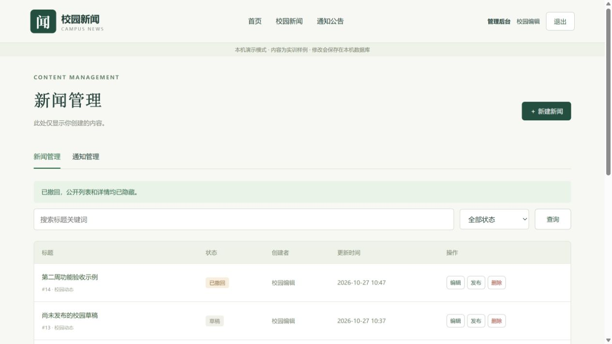
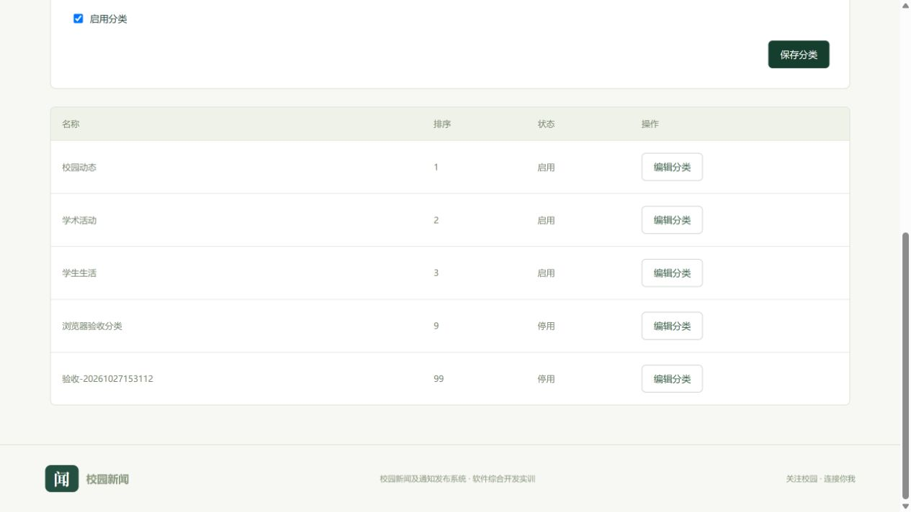
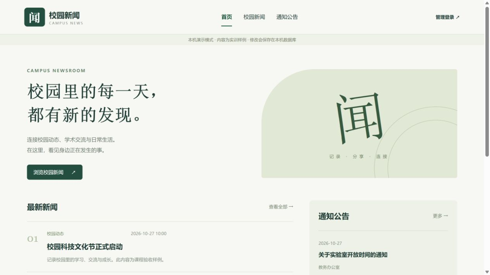

# 第二周验证记录

验证日期：2026-10-27。记录区分实际执行结果和未覆盖范围。

## 1 自动化与构建

| 检查 | 结果 | 范围 |
| --- | --- | --- |
| `mvn -B package` | 19 项测试，0 失败、0 错误、0 跳过；打包通过 | 独立内存 H2 的 Spring Boot 集成测试 |
| `npm.cmd run build` | 通过；18 个模块转换成功 | Vue 生产构建 |
| MySQL 8.0.33 建表 | 成功创建四张表 | 上次执行阶段的临时实例 127.0.0.1:13307，独立数据目录 |
| MySQL 真实 HTTP 验收脚本 | 全部通过 | 上次执行阶段 mysql profile、临时 8081 端口、真实 Cookie/CSRF |
| demo 真实 HTTP 验收脚本 | 全部通过 | 本次恢复工作后重新运行，8080 端口 |

后端测试覆盖密码哈希与响应脱敏、错误/禁用账号、真实登录会话、退出、缺少 CSRF、真实令牌登录后刷新、匿名后台拒绝、创建者隔离、管理员访问、伪造创建者及状态、发布撤回重发、已发布编辑回草稿、非法状态操作、输入空白与长度限制、分类有效性、检索分页、LIKE 通配符转义、注入文本、非法分页及状态、通知流程、分类管理权限和重名。

MySQL 脚本实际完成：管理员初始化后登录 → 数据库 SELECT 1 → 新建分类 → 新闻新建/编辑/发布/中文检索分页/撤回/删除 → 通知同样流程 → 停用验收分类 → 退出确认。19 项完整集成测试使用 H2；MySQL 执行上述核心业务脚本。

临时 MySQL 和 8081 应用已停止，临时明文凭据文件已删除；原有 3306 实例未修改。临时 MySQL 数据目录仍位于项目 `.local/mysql-verification`，已被忽略规则排除；删除该目录的清理操作被自动审批策略阻止，不影响功能及验收。

保留本机 demo 的 8080 后端、5173 前端供用户验收，重启电脑或结束进程后需按 README 重新启动。

## 2 浏览器实际操作

上次已通过真实页面完成：

- 首页读取公开新闻与通知。
- editor 登录，后台只显示其创建的内容。
- 新建“第二周功能验收示例”，保存为草稿。
- 点击发布，前台详情显示标题、摘要与中文换行正文。
- 点击撤回，状态变为已撤回；此前公开详情显示“内容不存在或未发布”。
- 退出后返回首页，恢复“管理登录”入口。
- 公开新闻下一页切换到第 2/2 页。
- 中文关键词“图书馆”检索得到 1 条匹配新闻，页码回到 1/1。

恢复工作后补查管理员登录，确认其可查看校园编辑与另一位编辑的内容；实际新建“浏览器验收分类”、设置排序为 9，再编辑停用并保存。另修正退出时路由守卫与首页跳转的竞争，已实测从分类管理页面退出后回首页，导航恢复“管理登录”。修改后前端再次构建通过。

浏览器创建的验收新闻保留为撤回状态，不出现在公开列表。脚本创建的新闻/通知已删除，带时间标记的验收分类已停用保留。截图为当时状态，后续操作可能改变页面数据。

## 3 未覆盖范围

没有完成生产部署、压力测试、全部浏览器兼容性测试或完整无障碍测试。页面具备响应式布局，但尚未全面实测移动端。未替本人完成课程报告中的个人实测截图、总结和签字，也没有执行 Git 命令、提交或推送。

固定演示账号仅用于本地 demo 模式；MySQL 使用显式指定的初始化管理员。验收本人数据库时需按 06 文档配置并截图。账号管理页面、上传、富文本与审核流尚未实现。
