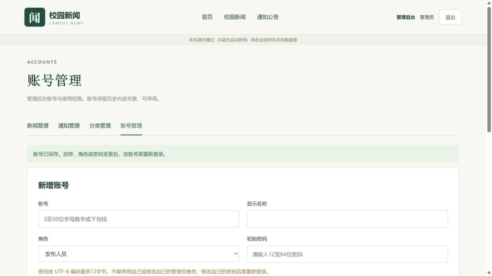
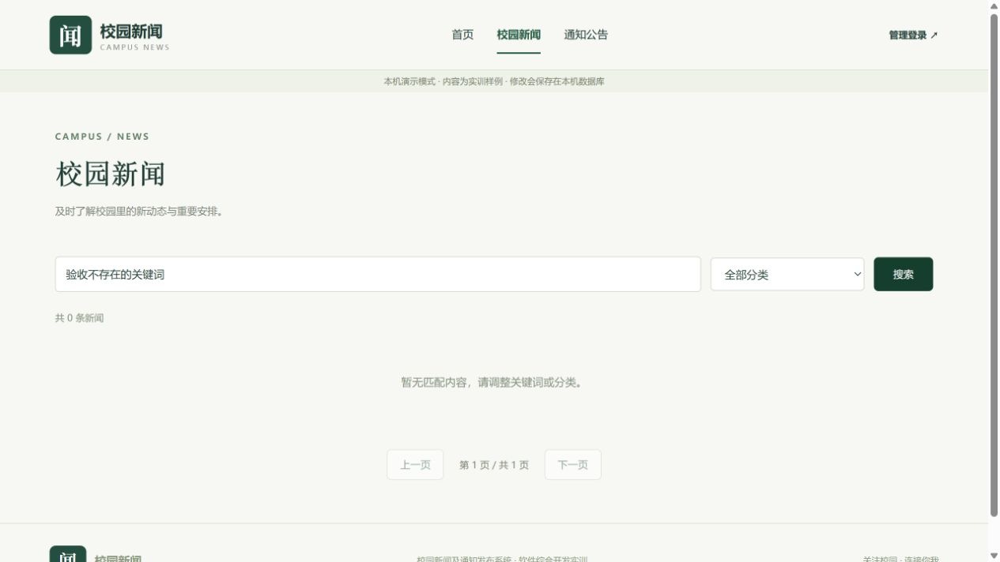

# 第三周实现与测试记录

日期：2026-10-28。根据第三周周记完成核心实现、综合测试、材料整理；现场答辩与教师意见需要本人参加后记录。

## 本周新增内容

- 新增 AccountController、AccountService 和 AccountPage，实现管理员账号分页查询、新增、改名、角色变更、启停和密码重设。
- UserRepository 新增账号读取、查询、写入和管理员计数。管理写操作在事务中锁定账号记录，保护启用管理员；禁止停用或降级当前管理员。用户名不可改，账号不提供物理删除，内容的创建者外键保留。
- SecurityConfig 注册 SessionRegistry 与 HttpSessionEventPublisher，账号启停、角色或密码变化后撤销旧会话，下一次请求返回401并要求重新登录。单纯改显示名称不退出登录。
- 密码须12至64位且UTF-8编码不超过72字节，避免BCrypt长输入超限；账号初始化同步校验。同一密码经过BCrypt处理后写库，响应不返回密码或哈希。
- 前端新增账号入口与表单，当前管理员角色/启用控件不可更改；后端也执行相同校验。修正非法后台子路由为空白的问题。项目信息阶段更新为week3。
- 新增 scripts/verify-accounts.ps1，结合原 smoke-test.ps1 可独立重复验收业务。

## 测试方法和实际结果

| 验证 | 实际结果 | 数据环境 |
| --- | --- | --- |
| mvn -B package | 28项集成测试通过，0失败0错误0跳过；JAR构建成功 | H2内存独立测试库 |
| npm.cmd run build | 19个模块构建通过 | Vue生产构建 |
| smoke-test.ps1 | 登录、分类、新闻/通知增改发布搜索分页撤回删除及退出均通过 | demo文件库、MySQL各执行一次 |
| verify-accounts.ps1 | 新增账号、重名、发布人员越权、改名、变更角色、密码重设、停用重启用、旧会话失效、保护当前管理员均通过 | demo文件库、MySQL各执行一次 |
| 浏览器 | 管理员登录、账号入口/列表、修改停用测试账号名称、保存反馈、退出首页、公开空结果提示通过 | 5173前端与8080 demo后端 |

MySQL实测使用8.0.33、127.0.0.1:13308的独立临时实例，后端mysql profile在8081运行。四表由 database/schema.sql 导入，网站管理员通过显式bootstrap创建。测试完成后停止临时实例和8081应用，删除临时明文凭据，保留已忽略的测试数据目录。用户已有3306实例未修改。MySQL执行真实HTTP脚本，不把28项H2测试误报为全部MySQL测试。

## 正常与异常用例摘录

| 编号 | 输入或操作 | 预期 | 实际 |
| --- | --- | --- | --- |
| T01 | 正确/错误密码登录 | 成功建立会话/401 | 通过 |
| T02 | 新建新闻及通知 | 草稿、创建者来自会话 | 通过 |
| T03 | 发布后读取、撤回后读取 | 公开可见/404 | 通过 |
| T04 | 修改已发布内容 | 回草稿并从公开端隐藏 | 通过 |
| T05 | 分类与关键词分页、空查询 | 条数页数正确，空列表正常 | 通过 |
| T06 | 发布人员请求他人内容 | 403，不能改数据 | 通过 |
| T07 | 标题空白、分类无效、页码非法 | 400及明确提示 | 通过 |
| T08 | 缺CSRF写操作 | 403 | 通过 |
| T09 | 管理员创建、查询账号 | 成功，响应无密码/哈希 | 通过 |
| T10 | 用户名重复、不合法、密码超字节 | 409或400 | 通过 |
| T11 | 改角色/重设密码/停用账号 | 旧会话401，重新登录按新状态认证 | 通过 |
| T12 | 重新启用被停账号后重用旧会话 | 仍为401，必须新登录 | 通过 |
| T13 | 停用或降级当前管理员 | 409，至少保留可用管理员 | 通过 |
| T14 | 仅修改显示名称 | 原密码、会话和内容创建者关联保留 | 通过 |
| T15 | HTML样式正文、损坏JSON | 纯文本存取/400 | 通过 |

28项测试的逐项方法与结果以 backend/target/surefire-reports/cn.edu.campus.news.ProjectApiTest.txt 和同目录XML为运行证据；target不纳入源码提交，重新执行Maven可生成。

## 代码和交付文件

本周修改 Models、UserRepository、SecurityConfig、DataInitializer、ProjectController、App、导航组件、ProjectApiTest；新增 AccountController、AccountService、AccountPage 和 verify-accounts.ps1。数据库不新增列，不需要把已有四表删除重建。

- docs/10-系统验收操作指南.md：完整运行说明、现场演示和答辩提示。
- 项目上一级 成果文件/新闻发布系统_教师验收操作指南.docx：可打印的完整演示手册。
- 项目上一级 成果文件/新闻发布系统_完整实训报告.docx：按课程模板组织的报告，含任务书、设计、测试、AI协作、总结和空白成绩表。
- 项目上一级 成果文件/新闻发布系统_第三周源码与运行说明.zip：排除.git、依赖、构建产物、本地数据库和密码的源码包。

## 复验和限制

从项目根目录执行以下脚本，按提示输入网站管理员密码。脚本会创建测试分类/账号，最终停用保留；只清理脚本自己创建的新闻/通知，不操作其他内容。

```powershell
& .\scripts\smoke-test.ps1
& .\scripts\verify-accounts.ps1
```

目前仍不包含富文本、图片附件、评论、注册、找回密码或复杂审核流。未做生产部署、压力测试或所有浏览器兼容验证。会话注册表位于应用内存，面向单后端实例。本人须核对报告中的AI协作说明、复现测试并补充实际答辩/教师整改记录；不能把工具执行的验证写成已经由本人独立完成。

实现参考：[Spring Security会话管理官方文档](https://docs.spring.io/spring-security/reference/6.5/servlet/authentication/session-management.html)。

## 可随源码提交的验证证据

- [28项测试摘要](test-evidence/week3-junit-summary.txt)
- [逐项测试方法与结果](test-evidence/week3-test-cases.txt)
- [MySQL内容业务实测输出](test-evidence/week3-mysql-content.txt)
- [MySQL账号管理实测输出](test-evidence/week3-mysql-accounts.txt)




